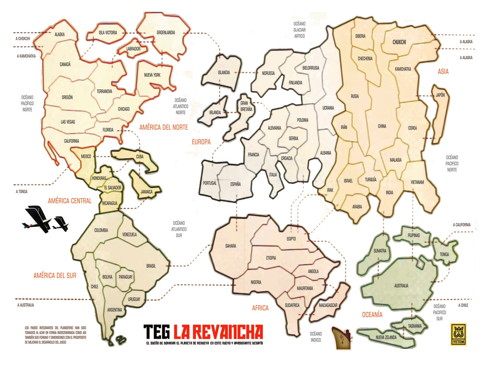

# TEG: La Revancha — Edición digital 🎲

**Adaptación digital no oficial del juego de mesa TEG: La Revancha**, desarrollada en **Python** con **Pygame**. Permite jugar contra rivales controlados por la computadora sobre un tablero interactivo de **72 países**, con sus propias reglas de objetivos, situaciones, misiles, tarjetas y diplomacia.

> **Estado:** proyecto personal en desarrollo y pruebas (versión 9). La lógica se ha probado automáticamente, pero pueden existir errores durante una partida. ¡Los reportes son bienvenidos!



## 🎮 Características

- **Partidas de 2 a 6 jugadores:** un jugador humano y de 1 a 5 bots, con elección del color y rotación del orden de turno.
- **Bots con distintos estilos:** agresivo, defensivo, oportunista, equilibrado y enfocado en la misión.
- **72 territorios y 7 continentes**, con fronteras y conexiones propias de La Revancha.
- **Objetivos secretos** de conquista o eliminación de otros colores; posibilidad de excluir las misiones de destrucción antes de comenzar.
- **Fases de juego:** preparación, incorporación de ejércitos, ataques, reagrupamientos y tarjetas. Todos los jugadores incorporan antes de comenzar los ataques de la ronda.
- **Batallas con dados automáticos**, tomando la cantidad máxima permitida por las reglas.
- **Misiles:** compra o conversión, alcance de hasta tres fronteras, defensa antimisiles y captura de misiles existentes al conquistar un país.
- **Tarjetas de países, continentes y canjes**, con sus bonificaciones y símbolos gráficos.
- **Mazo de 50 situaciones:** Combate clásico, Nieve, Crisis, Viento a favor, Refuerzos extras, Fronteras abiertas, Fronteras cerradas y Descansos por color. Las situaciones comienzan a extraerse a partir de la **segunda ronda**.
- **Sistema de pactos vinculantes:** acuerdos de no agresión, zonas internacionales, agresiones conjuntas y territorios en condominio, con negociación entre el humano y los bots.
- **Interfaz visual** con mapa interactivo, menú contextual al hacer clic derecho sobre las fichas, historial, objetivos ilustrados, indicadores de misiles y resumen de refuerzos libres o específicos de cada continente.

## 🖥️ Requisitos

- Python **3.10 o posterior**.
- [Pygame](https://www.pygame.org/) **2.5 o posterior, anterior a 3**.
- Windows para utilizar el lanzador `.bat`; también se puede ejecutar desde una terminal en otros sistemas que admitan Python y Pygame.
- Se recomienda una pantalla de aproximadamente **1600 × 900** píxeles; la interfaz puede escalar a resoluciones menores.

## 🚀 Instalación y ejecución

1. Cloná el repositorio o descargá su contenido como ZIP.
2. En Windows, ejecutá **`INICIAR_JUEGO.bat`** desde la carpeta principal del proyecto. El lanzador instala las dependencias necesarias y abre el juego.

**Ejecución manual (Windows, Linux o macOS):**

```bash
cd teg_revancha
python -m pip install -r requirements.txt
python main.py
```

En algunos equipos el comando de Python puede ser `python3` o `py`.

## 🕹️ Controles

| Acción | Control |
| --- | --- |
| Seleccionar un territorio | Clic izquierdo sobre la ficha |
| Abrir acciones disponibles para un territorio | **Clic derecho** sobre la ficha |
| Consultar tarjetas | **T** |
| Ver objetivos | **O** |
| Abrir diplomacia y pactos | **P** |
| Consultar historial | **H** |
| Ajustar velocidad de los bots | **F** |
| Aceptar / rechazar una propuesta de un bot | **A / R** |

Los botones del panel lateral siguen disponibles como alternativa al menú contextual. Las acciones visibles dependen de la fase del turno y del país seleccionado.

## 📂 Estructura del proyecto

```text
TEG_La_Revancha/
├── INICIAR_JUEGO.bat
├── README.md                     # Presentación del repositorio
├── CAMBIOS_Y_PRUEBAS.md           # Registro técnico de cambios y pruebas
├── TEG-REVANCHA-REGLAS.pdf        # Reglamento de referencia
├── Tarjetas países.pdf
├── Tarjetas objetivos.pdf
└── teg_revancha/
    ├── main.py                    # Entrada del juego y gestión de eventos
    ├── logic.py                   # Motor de reglas y turnos
    ├── data.py                    # Países, fronteras, coordenadas y tarjetas
    ├── pactos.py                  # Reglas de diplomacia
    ├── respuestas_pactos.py       # Respuestas y flujos de pactos
    ├── renderer.py                # Interfaz gráfica Pygame
    ├── requirements.txt
    ├── mapa_ui.jpg                # Mapa usado por la interfaz
    ├── mapa.jpg                   # Imagen original del mapa
    ├── iconos_cartas/
    ├── iconos_ui/
    ├── objetivos_imagenes/
    ├── test_reglas.py
    ├── test_pactos.py
    └── test_correcciones_v*.py
```

## 🧪 Ejecutar las pruebas

Desde la carpeta `teg_revancha`:

```bash
python -m unittest -v test_reglas test_pactos test_correcciones_v7 test_correcciones_v8 test_correcciones_v9
```

La versión 9 incluye **90 pruebas automatizadas** que comprueban, entre otras cosas, reglas de turnos, conexiones, pactos y compra/conversión de misiles. Las pruebas automatizadas no sustituyen las partidas manuales para detectar problemas visuales o de interacción.

## 🛠️ Tecnologías

- **Python**: reglas, estado de la partida y comportamiento de los bots.
- **Pygame**: renderizado del mapa, interfaz gráfica y entrada de teclado/ratón.
- **`unittest`**: pruebas automatizadas del motor.

## 📌 Estado y mejoras futuras

El proyecto se encuentra en evolución, con especial atención al ajuste de la inteligencia de los bots, la ergonomía de la interfaz, la validación de pactos complejos y la corrección de errores detectados durante partidas reales.

Si encontrás un problema, abrí un **Issue** indicando qué estabas haciendo, el comportamiento esperado y, de ser posible, el mensaje de error o una captura.

## ⚠️ Aviso sobre derechos

Este es un **proyecto personal, no oficial y sin afiliación con los titulares de TEG: La Revancha**. El nombre, el reglamento y los materiales gráficos originales pertenecen a sus respectivos titulares. Su inclusión en este repositorio **no implica que estén bajo una licencia abierta**. Antes de publicar o redistribuir las imágenes, tarjetas y PDF originales, verificá que contás con los permisos correspondientes.

No se declara una licencia de código en este README: si querés permitir que otras personas lo reutilicen, podés añadir un archivo `LICENSE` con una licencia apropiada para el código que tengas derecho a licenciar.
